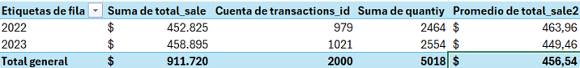
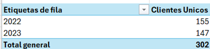
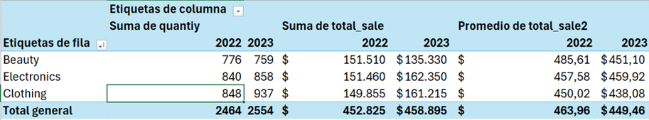
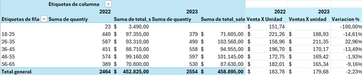
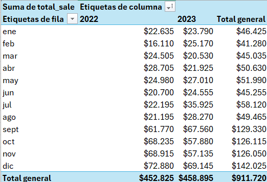
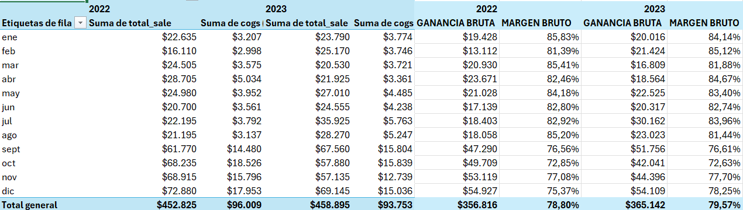
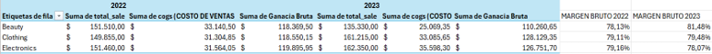

# Proyecto 1: Análisis de ventas – Retail Sales

 # Contexto
Una empresa comercial en Ecuador vende productos de tres categorías: Beauty, Clothing y Electronics. La gerencia necesita conocer cómo se comportaron las ventas durante 2022 y 2023 para identificar oportunidades de mejora y decidir en qué áreas enfocarse el siguiente año.

# Objetivo
Analizar las ventas, los clientes y las categorías de productos durante 2022 y 2023 para identificar cambios y oportunidades de mejora para el negocio.

# Preguntas de negocio
•	**Ventas:** ¿Cómo cambiaron las ventas y qué factores influyeron: transacciones, unidades o ticket promedio?					

•	**Clientes:** ¿Cuántos clientes se mantuvieron, se perdieron o llegaron? ¿Qué importancia tuvieron los clientes perdidos?

•	**Categorías:** ¿Qué categoría generó más ventas y cuál presenta oportunidades de mejora?

•	**Rentabilidad:** ¿Qué categoría obtuvo el mayor margen bruto y cómo cambió respecto al año anterior?

# Indicadores utilizados
Ventas, transacciones, unidades vendidas, ticket promedio, clientes recurrentes, clientes perdidos, ganancia bruta y margen bruto.

# Datos
• **Fuente:** Retail Sales Dataset – Kaggle

•	**Registros:** 2.000 transacciones.

•	**Periodo:** enero de 2022 a diciembre de 2023.

•	**Categorías:** Beauty, Clothing y Electronics.

•	**Herramienta:** Microsoft Excel.

# Proceso
•	Revisión de la base de datos y de los valores faltantes.

•	Comparación de ventas, transacciones, unidades y ticket promedio.

•	Identificación de clientes recurrentes, perdidos y nuevos.

•	Comparación de ventas y unidades por categoría y grupo de edad.

•	Análisis de la evolución mensual de las ventas.

•	Cálculo de ganancia bruta y margen bruto por mes y categoría.

# Principales hallazgos

•	**Ventas:** En 2023, las ventas aumentaron un 1,34 % y las transacciones un 4,29 %. Sin embargo, el ticket promedio disminuyó un 3,13 %.
 
 
•	**Clientes:** Se identificaron 147 clientes recurrentes, 8 perdidos y ningún cliente nuevo. Los clientes perdidos representaron $12.725, equivalentes al 2,81 % de las ventas de 2022.

  
  
•	**Categorías:** Electronics generó las mayores ventas en 2023, mientras que Clothing registró más unidades vendidas. Por otro lado, Beauty presentó el mayor promedio de venta por transacción, pero sus ventas y unidades disminuyeron respecto a 2022, por lo que representa una oportunidad de mejora.
  
  
  
•	**Grupos de edad:** El grupo de 46–55 años registró la mayor cantidad de unidades vendidas en 2023. El grupo de 26–35 años presentó el mayor aumento en ventas por unidad respecto a 2022.
 
  
  
•	**Ventas mensuales:** Aunque las ventas anuales aumentaron, el comportamiento mensual fue desigual. Entre octubre y diciembre de 2023 las ventas fueron inferiores a las del mismo periodo de 2022.

 
 
•	**Ganancia y margen bruto:** El margen bruto general aumentó de 78,80 % en 2022 a 79,57 % en 2023. Sin embargo, los resultados variaron entre las categorías.
En 2022, Electronics obtuvo el mayor margen bruto, mientras que en 2023 fue Beauty. Esta última presentó una mejora en su margen, mientras que Electronics registró una disminución respecto al año anterior.

 

 
 
 
 
# Recomendaciones
  
•	**Beauty:** Revisar las razones de la disminución de ventas y unidades vendidas, a pesar de que su margen bruto mejoró.

•	**Electronics:** Revisar los costos de los productos, ya que sus ventas aumentaron, pero su margen bruto disminuyó.

•	**Clientes:** Analizar estrategias para mantener a los clientes actuales y atraer nuevos compradores.

•	**Ventas mensuales:** Revisar qué factores pudieron influir en la disminución de las ventas entre octubre y diciembre.

•	**Ticket promedio:** Evaluar acciones que ayuden a aumentar el valor promedio de cada compra.

# Limitaciones
•	Se identificaron valores faltantes en las columnas edad, precio unitario, cantidad (quantity), costo de ventas (COGS) y ventas totales (total_sale).

•	Se conservaron todos los registros porque no se contaba con información suficiente para determinar el motivo de los datos faltantes. Para cada cálculo se utilizaron los valores disponibles en las columnas correspondientes.

•	Los registros sin edad asignada se conservaron para los análisis de ventas, pero no pudieron clasificarse por grupo de edad.

•	Se identificaron clientes con el mismo ID, pero con diferentes edades en distintos años. Esto dificultó representar correctamente a los clientes por grupo de edad.

# Mejoras futuras
•	Contar con una base de datos con menos valores faltantes y mayor consistencia en la información.

•	Verificar y mantener actualizados los datos de edad de los clientes.

•	Incorporar información de gastos adicionales, como alquiler, sueldos y publicidad, para analizar la rentabilidad neta del negocio.

•	Contar con información más detallada de los productos para profundizar el análisis por categoría.

